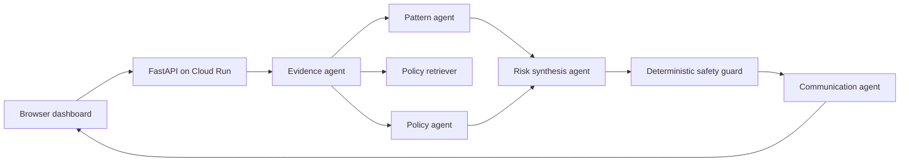

# TrustLens APAC

## Grounded, explainable scam prevention for digital payments

TrustLens APAC is a Google Cloud prototype for the **BFSI: Intelligent Risk, Fraud & Financial Experiences** theme of the AI Builder Cup 2026. It helps a person or support analyst understand a suspicious payment message before money or credentials are exposed.

TrustLens accepts suspicious text and optional screenshots. It extracts observable evidence with Gemini, compares the evidence with grounded scam-pattern policies, synthesizes a conservative risk band, applies deterministic safety rules, and explains the recommended next step in the user’s selected language.

> TrustLens is an assisted-prevention prototype. It does not move money, freeze accounts, contact a bank, make credit decisions, or replace an institution’s official fraud process.

## Why this problem matters

Digital-payment scams combine social engineering with technical deception. A message can imitate a trusted institution, create urgency, request a one-time password, redirect a refund, or ask a user to install remote-access software. The user needs a clear next action, while a support team needs a traceable explanation rather than an opaque model score.

TrustLens focuses on a narrow, demonstrable intervention:

> **Before a user sends money or credentials, turn confusing evidence into a safe and explainable next step.**

## Product capabilities

| Capability | What the prototype demonstrates |
|---|---|
| Text analysis | Accepts a suspicious message or transaction context. |
| Multimodal analysis | Accepts JPEG, PNG, and WebP screenshots up to 8 MB. |
| Evidence extraction | Identifies claimed sender, requested actions, urgency signals, URLs, entities, and evidence references. |
| Scam-pattern reasoning | Evaluates impersonation, credential harvesting, suspicious links, fake refunds, remote access, and urgency pressure. |
| Grounded policy guidance | Retrieves relevant safety policies from a versioned prototype corpus. |
| Conservative risk bands | Returns `low`, `review`, or `high`; the output is not a production fraud probability. |
| Deterministic safety guard | Prevents unsafe recommendations such as sharing an OTP or installing remote-access software. |
| Human review | Routes high-risk, ambiguous, or unsupported cases to review. |
| Localized communication | Generates plain-language next steps in the selected language. |
| Audit metadata | Returns model, grounding-source, image-analysis, and review status metadata. |

## Judging alignment

The design directly targets the official judging rubric:

| Official criterion | Weight | TrustLens evidence |
|---|---:|---|
| Technical Merit & GenAI Implementation | 40% | Gemini multimodal extraction, schema-constrained outputs, bounded specialized agents, deterministic safety guard, grounding, Cloud Run deployment. |
| Problem Alignment & Impact | 25% | Clear scam-prevention workflow, consumer and analyst personas, measurable synthetic evaluation set, safe next action. |
| Innovation & Creativity | 25% | Evidence-first risk explanation and human-review boundary instead of a generic financial chatbot. |
| User Experience & Solution Design | 10% | Responsive dashboard with intake, result explanation, risk badge, evidence trail, policy actions, and review controls. |

Official program pages: [overview](https://aibuildercup.com/), [themes and requirements](https://aibuildercup.com/themes.html), [rewards](https://aibuildercup.com/rewards.html), and [FAQs](https://aibuildercup.com/Faqs.html).

## Repository structure

```text
.
├── app.py                         # FastAPI Cloud Run HTTP service
├── trustlens_pipeline.py          # Core bounded Gemini orchestration
├── requirements.txt               # Backend dependencies
├── Dockerfile                     # Cloud Run container image
├── cloudrun-service.yaml          # Cloud Run service manifest template
├── deploy-cloud-run.sh            # Artifact Registry + Cloud Run deployment
├── .dockerignore
├── trustlens-dashboard/
│   ├── app/page.tsx               # Next.js dashboard
│   ├── app/page.module.css        # Dashboard design system
│   ├── app/layout.tsx
│   ├── app/globals.css
│   ├── lib/trustlens-api.ts       # Browser API client
│   ├── types.ts                   # Shared frontend models
│   ├── package.json
│   └── tsconfig.json
└── trustlens-docs/
    ├── JUDGES_GUIDE.md
    ├── DEMO_SCRIPT.md
    ├── ARCHITECTURE.md
    ├── RESPONSIBLE_AI.md
    ├── EVALUATION_PLAN.md
    └── SUBMISSION_CHECKLIST.md
```

## Architecture at a glance



The pipeline is intentionally bounded. It executes five model calls: evidence extraction; parallel pattern and policy analysis; risk synthesis; and localized communication. It does not permit an unconstrained agent to call financial systems.

## Local backend setup

### Prerequisites

- Python 3.11 or later.
- A Google Cloud project.
- Vertex AI API enabled.
- Application Default Credentials configured.
- A Gemini model enabled in the selected region.

### Install

```bash
python3 -m venv .venv
source .venv/bin/activate
pip install -r requirements.txt
```

### Configure credentials and environment

```bash
gcloud auth application-default login
gcloud config set project YOUR_PROJECT_ID

export GOOGLE_CLOUD_PROJECT="YOUR_PROJECT_ID"
export GOOGLE_CLOUD_LOCATION="global"
export GEMINI_MODEL="gemini-2.5-flash"
```

### Run the API

```bash
uvicorn app:app --host 0.0.0.0 --port 8080 --reload
```

The local API is available at `http://localhost:8080`. OpenAPI documentation is available at `http://localhost:8080/docs`.

### Test a text case

```bash
curl -X POST http://localhost:8080/v1/analyze/text \
  -H 'Content-Type: application/json' \
  -d '{
    "message": "Your refund is pending. Share your OTP and click http://example.test to release the money.",
    "language": "en"
  }'
```

### Test a screenshot case

```bash
curl -X POST http://localhost:8080/v1/analyze/multipart \
  -F 'message=Your refund is pending. Share your OTP.' \
  -F 'language=en' \
  -F 'screenshot=@./screenshot.png'
```

## Local frontend setup

```bash
cd trustlens-dashboard
npm install
```

Create `trustlens-dashboard/.env.local`:

```bash
NEXT_PUBLIC_TRUSTLENS_API_URL=http://localhost:8080
```

Run the dashboard:

```bash
npm run dev
```

Open `http://localhost:3000`.

The production build is validated with:

```bash
npm run build
```

## Cloud Run deployment

From the repository root:

```bash
export PROJECT_ID="YOUR_PROJECT_ID"
export REGION="asia-southeast1"
./deploy-cloud-run.sh
```

The script enables required APIs, creates an Artifact Registry repository, builds the image with Cloud Build, creates the runtime service account, grants `roles/aiplatform.user`, deploys the service, and prints the Cloud Run URL.

The default deployment enables unauthenticated invocation for a hackathon demo. This is intentional for the public judge link. For production, remove the `allUsers` invoker binding and place Firebase Authentication, Identity-Aware Proxy, or an authenticated gateway in front of the API.

## API contract

### `GET /healthz`

Returns:

```json
{"status":"ok"}
```

### `POST /v1/analyze/text`

Request:

```json
{
  "message": "Your refund is pending. Share your OTP.",
  "language": "en"
}
```

### `POST /v1/analyze/multipart`

Multipart fields:

- `message`: required string.
- `language`: optional language code.
- `screenshot`: optional JPEG, PNG, or WebP file up to 8 MB.

### Response shape

```json
{
  "case_id": "TL-ABC123",
  "risk": {
    "risk_band": "high",
    "confidence": 0.91,
    "scam_patterns": ["credential_harvesting", "fake_refund"],
    "evidence_ids": ["e1", "e2"],
    "rationale": ["The sender requests a one-time password."],
    "recommended_action": "Do not share credentials. Contact the institution using an independently verified channel.",
    "prohibited_actions": ["Do not share an OTP."],
    "human_review_required": true,
    "uncertainty": []
  },
  "communication": {
    "language": "en",
    "headline": "Stop before sharing your code",
    "explanation": "The message contains multiple high-risk indicators.",
    "next_steps": ["Open the official banking application directly."],
    "do_not_do": ["Do not click the unsolicited link."],
    "disclaimer": "This is an educational prototype."
  },
  "audit": {
    "model": "gemini-2.5-flash",
    "agent_budget": 5,
    "grounding_sources": ["policy-otp-001"],
    "image_analyzed": false,
    "human_review_required": true,
    "prototype_notice": "Synthetic/demo workflow; not a banking decision engine."
  }
}
```

## Limitations and prototype boundaries

The current prototype contains an in-process policy corpus. A production implementation should replace it with Vertex AI Search or another governed retrieval layer.

The dashboard’s analyst review controls are a judge-facing interaction demonstration. They update local UI state. A production implementation should persist review actions in Firestore with authentication, authorization, immutable audit events, and case ownership.

The current service does not persist evidence or case records. A production version should add Cloud Storage for evidence, Firestore for case state, deletion TTLs, and Cloud Logging/Monitoring dashboards.

The evaluation targets described in the submission documents are prototype targets on synthetic data. They are not claims about real-world fraud performance.

## Security notes

Never place real OTPs, account numbers, passwords, identity numbers, or payment credentials in the demo. Use synthetic cases.

The backend removes uploaded screenshots from the local temporary directory after analysis. Cloud Run’s ephemeral filesystem is not a durable evidence store. If persistence is added, use encrypted Cloud Storage, strict access controls, short retention, and deletion policies.

The service account requires only Vertex AI usage for the current reference deployment. Future Cloud Storage or Firestore access should be granted with narrowly scoped roles.

## Judge quick start

1. Open the deployed dashboard.
2. Click **Use example**.
3. Click **Analyze safely**.
4. Observe the high-risk result, evidence rationale, policy action, and human-review banner.
5. Expand the raw API response and audit trace.
6. Upload a screenshot to demonstrate multimodal analysis.
7. Use the review controls to demonstrate the human-in-the-loop boundary.

For the full judging path, read [`trustlens-docs/DEMO_SCRIPT.md`](trustlens-docs/DEMO_SCRIPT.md).

## License and data notice

This repository is a hackathon prototype. It is intended for evaluation and educational use. It must not be used as a production financial decision system without security, privacy, compliance, model-risk, and operational review.
