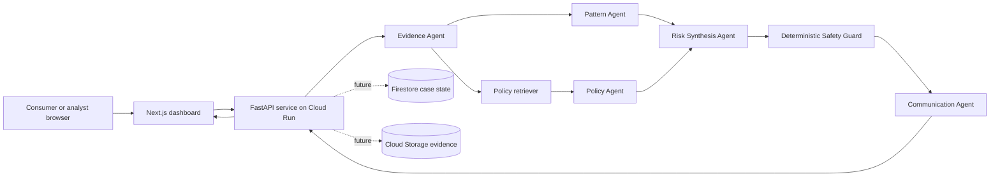
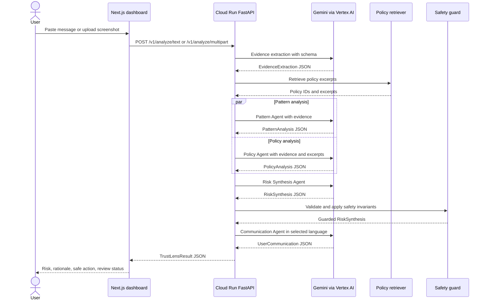

# TrustLens APAC: Architecture and Sequence

## System context

## Runtime components

### Browser dashboard

The Next.js App Router frontend provides intake, file validation, language selection, result rendering, analyst review demonstration, and raw audit-trace inspection. The browser calls the FastAPI service through a configurable `NEXT_PUBLIC_TRUSTLENS_API_URL`.

### Cloud Run API

The FastAPI service exposes health, text-analysis, and multipart-analysis endpoints. It validates message length, image content type, and image size. Uploaded files are written to a temporary path only for the duration of analysis and deleted in a `finally` block.

### Gemini orchestration

The backend uses the Google Gen AI Python SDK with Vertex AI. Each agent is given a narrow responsibility and a Pydantic response schema. The model is configured for JSON output and temperature zero.

### Grounding

The prototype retriever scores a small in-process corpus by keyword overlap and returns the highest-scoring policy excerpts. Each excerpt has a stable policy ID. Production should use a governed Vertex AI Search data store or equivalent retrieval layer and retain source metadata.

### Safety guard

The safety guard is ordinary Python logic that runs after risk synthesis. It detects unsafe recommendations involving OTPs, passwords, PINs, suspicious links, or remote-access software. It can force a high-risk or human-review outcome and replace the recommendation with safe guidance.

## Agent contract

| Agent | Input | Output | Failure behavior |
|---|---|---|---|
| Evidence Agent | User text and optional image | Language, message text, requested actions, URLs, entities, urgency signals, evidence items, uncertainty | Retry; fail request if schema remains invalid. |
| Pattern Agent | Evidence extraction | Bounded scam-pattern matches, rationale, evidence IDs, confidence | Retry; synthesis cannot proceed without valid output. |
| Policy Agent | Evidence plus retrieved policy excerpts | Policy findings, safe actions, prohibited actions, human-review flag | Retry; only supplied policy IDs may be returned. |
| Risk Synthesis Agent | Evidence, pattern output, policy output | Risk band, confidence, rationale, evidence IDs, safe action, prohibited actions, review flag, uncertainty | Retry; deterministic safety guard runs after output. |
| Communication Agent | Language and final risk synthesis | Headline, explanation, next steps, do-not-do list, disclaimer | Retry; return structured error if unavailable. |

## Sequence of events

## Security boundary

The browser never receives service credentials. Vertex AI calls occur server-side. The public demo endpoint is intentionally unauthenticated only to make judge access simple. Production deployment requires authenticated invocation, request-level authorization, abuse controls, App Check or equivalent, rate limiting, and audit logging.

## Production evolution

1. Replace the in-process corpus with a versioned, reviewed retrieval data store.
2. Persist cases, review decisions, and audit events in Firestore.
3. Store consented evidence in encrypted Cloud Storage with TTL deletion.
4. Add Firebase Authentication and role-based analyst authorization.
5. Add Pub/Sub and a Cloud Run worker for asynchronous evidence processing.
6. Add Cloud Logging, Error Reporting, latency metrics, model-cost metrics, and alerting.
7. Add offline regression tests for every prompt and policy version.
